

# 🗺️ PhD Roadmap Builder

**Plan your PhD, track your progress, and come to your CSI prepared.**

A free, offline tool for doctoral students: drag milestones onto a timeline, set your CSI dates, 
count what you achieve each year, and export a clean poster in PowerPoint or PDF.

<!-- 📸 HERO IMAGE: a full screenshot of the builder with a realistic roadmap -->
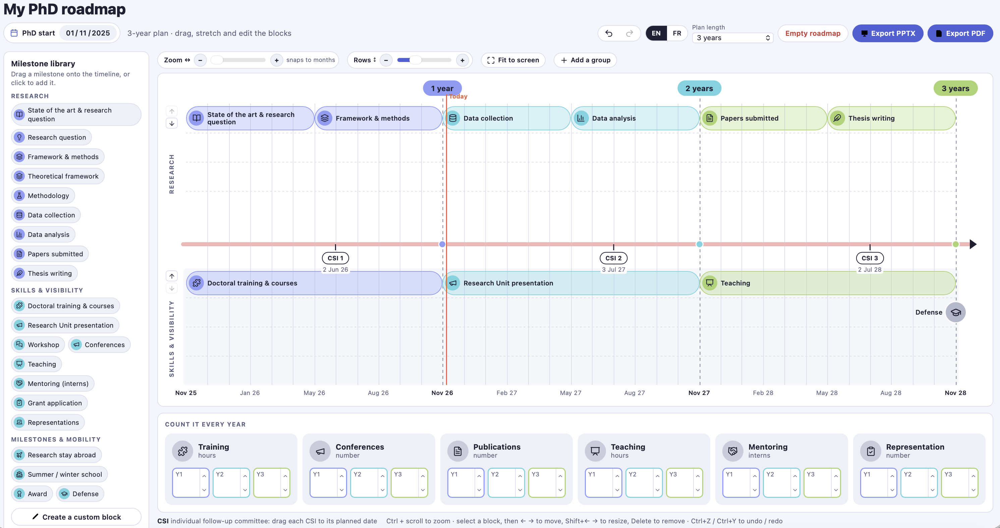

[**⬇️ Download the builder**](PhD_Roadmap_Builder.html) · [Quick start](#-quick-start-2-minutes) · [Tutorial](#-tutorial) · [FAQ](#-faq--troubleshooting)

---

## 📚 Contents

- [Why this tool?](#-why-this-tool)
- [What's in this repository](#-whats-in-this-repository)
- [Quick start (2 minutes)](#-quick-start-2-minutes)
- [Tutorial](#-tutorial) 
  1.[Set up your plan](#1-set-up-your-plan)
  2.[Add milestones](#2-add-milestones)
  3.[Edit a block](#3-edit-a-block)
  4.[Sub-blocks: break a task into steps](#4-sub-blocks-break-a-task-into-steps)
  5.[Organise rows into groups](#5-organise-rows-into-groups)
  6.[Place your CSI meetings](#6-place-your-csi-meetings)
  7.[Zoom from years to days](#7-zoom-from-years-to-days)
  8.[Yearly counters and personal goals](#8-yearly-counters-and-personal-goals)
  9.[Save and reopen your work](#9-save-and-reopen-your-work)
  10.[Export a poster (PPTX / PDF)](#10-export-a-poster-pptx--pdf)
- [Keyboard shortcuts](#%EF%B8%8F-keyboard-shortcuts)
- [The fillable CSI tracker (PDF)](#-the-fillable-csi-tracker-pdf)
- [Privacy: where is my data?](#-privacy-where-is-my-data)
- [FAQ & troubleshooting](#-faq--troubleshooting)
- [For maintainers](#-for-maintainers)

---

## 💡 Why this tool?

A PhD is long, and it is easy to lose track of where you are. The **CSI** (*comité de suivi individuel*, the individual follow-up committee) meets every year to check that things are on track. This tool helps you to:

| | |
|---|---|
| 🧭 **See the big picture** | Your three (or four) years on one page: research steps, training, conferences, teaching… |
| 📍 **Know where you are** | A *Today* line shows your position in the PhD as soon as you set your start date. |
| 🎯 **Set goals early** | Decide at the start how many training hours, talks or papers you are aiming for each year. |
| 📊 **Track progress** | Counters show what you have done against your goals, year by year. |
| 🖨️ **Share it** | Export a poster for your CSI, your supervisors or your lab wall. |

---

## 📦 What's in this repository

| File | What it is | Who it's for |
|---|---|---|
| [`PhD_Roadmap_Builder.html`](PhD_Roadmap_Builder.html) | The interactive roadmap builder. **One file, works offline.** | Every PhD student |
| [`Fiche_suivi_EN.pdf`](Fiche_suivi_EN.pdf) / [`Fiche_suivi_FR.pdf`](Fiche_suivi_FR.pdf) | Fillable CSI tracker based on Document A2 (tick boxes and number fields). | Students preparing a CSI |
| [`Fiche_suivi.pptx`](Fiche_suivi.pptx) | Editable source of the tracker and roadmap poster. | Committee members |

<!-- ✏️ Adjust this table to the files you actually upload. -->

---

## 🚀 Quick start (2 minutes)

> [!TIP]
> **Nothing to install.** No account, no internet connection, no Python, no Docker.

**1. Download** [`PhD_Roadmap_Builder.html`](PhD_Roadmap_Builder.html)
&nbsp;&nbsp;&nbsp;On GitHub: open the file, then click **⋯ → Download** (or the download icon ⬇️ at the top right of the file view).

**2. Double-click** the file. It opens in your web browser (Chrome, Firefox, Safari or Edge).

**3. Set your PhD start date** with the 📅 calendar under the title.

That's it. A default three-year roadmap is already there. Adapt it to your own project.

<!-- 🎞️ GIF: download → double-click → page opens → pick the start date (10 s max) -->
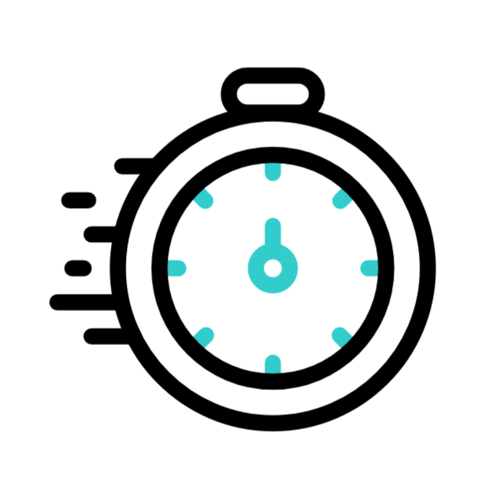

---

## 🎓 Tutorial

### 1. Set up your plan

| Control | Where | What it does |
|---|---|---|
| 📅 **PhD start** | Under the title | Turns month numbers into real dates and shows the *Today* line. |
| **Plan length** | Top right | 3 years, or 4 years if you have an extension. |
| **EN / FR** | Top right | Switches the whole interface and the default labels. |
| **Title** | Click on *My PhD roadmap* | Rename it, for example *Roadmap, Paul J., 2025–2028*. |

<!-- 📸 Annotated screenshot of the header: arrows pointing at title, start date, EN/FR, plan length -->
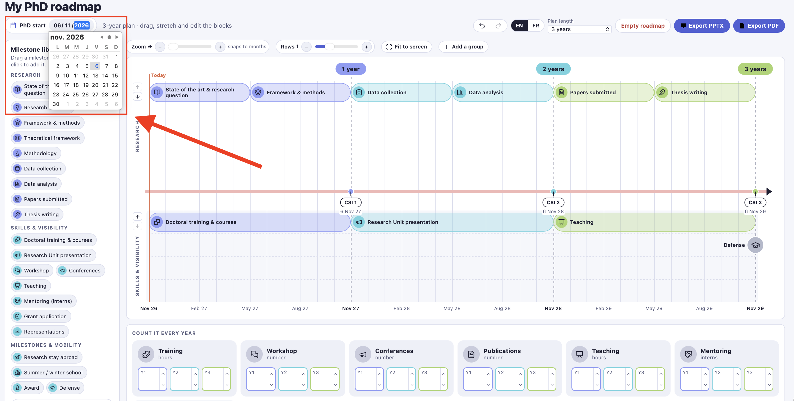
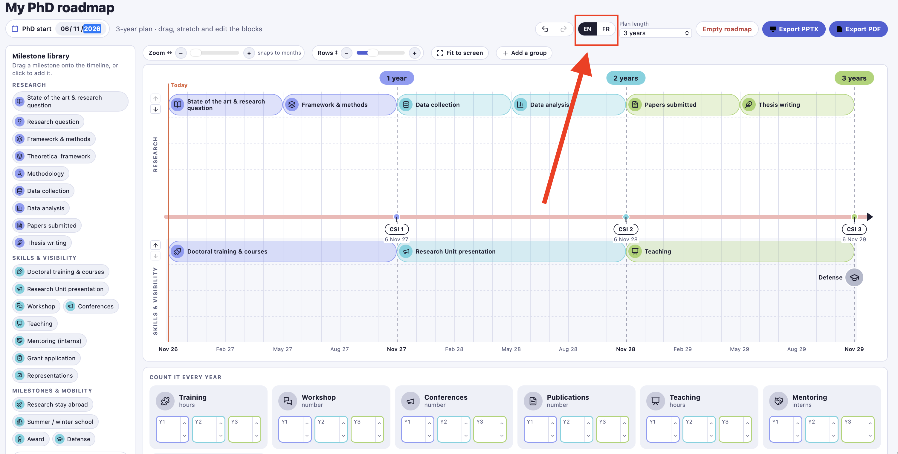

---

### 2. Add milestones

The **Milestone library** (left panel) holds ready-made blocks: state of the art, data collection, training, conferences, teaching, defense…

- **Drag** a milestone onto the timeline, exactly where you want it, **or**
- **Click** it to drop it at its usual place.

The timeline has two default **groups**:

| Group | Typical content |
|---|---|
| 🔬 **Research** | State of the art, methods, data collection, analysis, papers, thesis writing |
| 🌱 **Skills & visibility** | Training, seminars, conferences, teaching, mentoring, representation |

Need something that isn't in the library? Click **✏️ Create a custom block**.

<!-- 🎞️ GIF: drag "Data collection" from the library onto the timeline -->
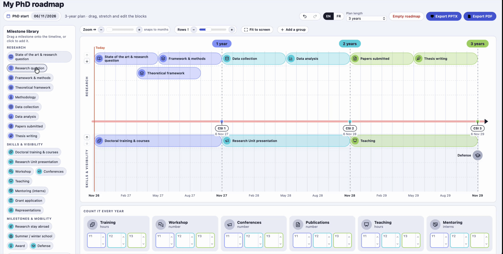
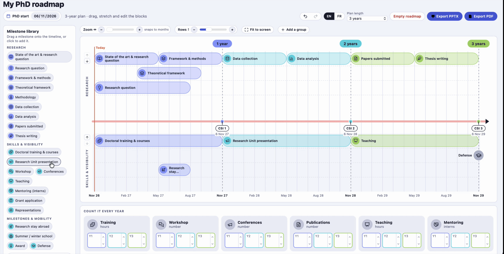

---

### 3. Edit a block

**Click any block** to open its editor right next to it.

| You can change | How |
|---|---|
| ✍️ Text | Type a new title |
| 🔣 Symbol | Pick one of 48 icons |
| 🎨 Colour | *Colour by year* (automatic) or one of 8 colours |
| 📆 Dates | Start and end date pickers (or start and length if no PhD start is set) |
| 📍 Milestone | Tick *Single date* for one-day events such as the defense |
| 🗂️ Group | Move the block to another group |

On the timeline itself:

- **Drag the block** to move it, left/right in time, up/down between rows.
- **Drag its left or right edge** to make it shorter or longer (from **1 day** to **4 years**).
- Close the editor with **✕**, <kbd>Esc</kbd>, or a click anywhere else.

> [!NOTE]
> When a title is too long for its block, it is cut at the edge. Click the block or zoom in to read it in full.

<!-- 🎞️ GIF: click a block → editor opens → change colour → drag its right edge to stretch it -->
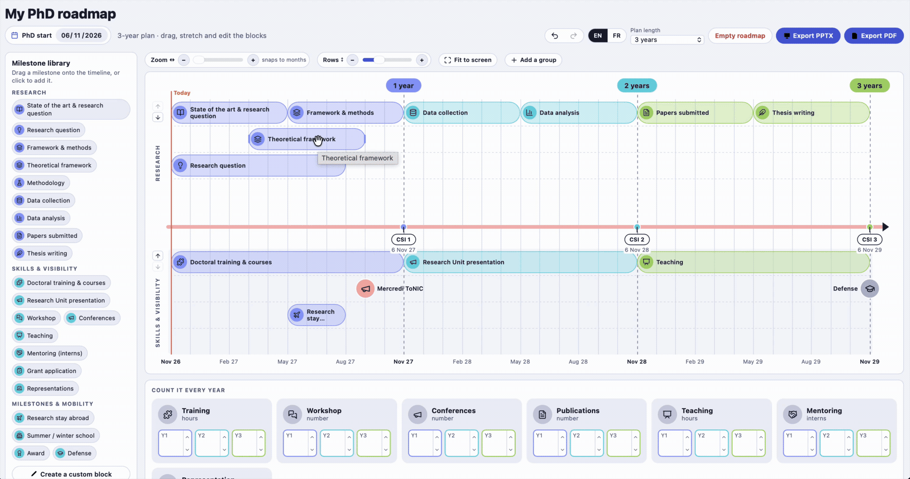

---

### 4. Sub-blocks: break a task into steps

Big tasks are easier to follow when split into steps. *Thesis writing* becomes *Introduction → Chapter 1 → Chapter 2 → Discussion*.

1. Click the main block (the **category**), for example *Thesis writing*.
2. Click **➕ Add a sub-block**. A thinner bar appears under it, in the same row.
3. Add more: each new sub-block starts where the previous one ends.
4. Need parallel steps? Use **Stacked sub-block levels** (− / +, up to 4) to stack them.

**Fold to keep things clean**

| Action | Where |
|---|---|
| Fold or unfold one category | Click **▾ 3** on the block, or the *Fold its sub-blocks* checkbox |
| Fold or unfold everything | **Fold all sub-blocks** above the timeline |

When you move a category, its sub-blocks move with it. Folded sub-blocks stay hidden in exports.

<!-- 🎞️ GIF: open Thesis writing → add 3 sub-blocks → set 2 levels → fold with ▾ -->
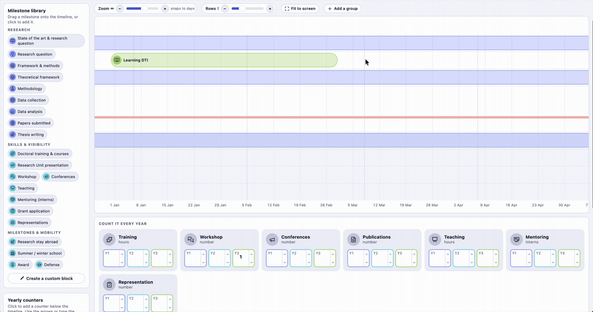

---

### 5. Organise rows into groups

On the left edge of the timeline, each group has:

- **⬆️ ⬇️ arrows** to change the order (for example, put *Skills & visibility* on top);
- its **name**: click it to rename the group, change its number of rows (1–8) or delete it.

**➕ Add a group** creates a new one, for example *Clinical work*, *Teaching duties* or *Collaboration with lab X*.

<!-- 📸 Close-up of the left edge: arrows + group name + the group editor open -->
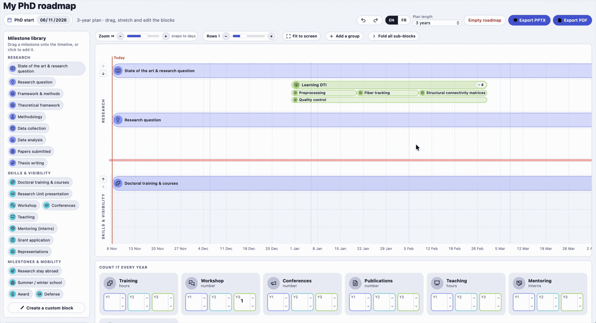

---

### 6. Place your CSI meetings

Each **CSI** marker sits on the central axis. **Drag it to the date your committee is actually planned.** Its date is shown under it, and markers are renumbered automatically.

> [!IMPORTANT]
> The CSI meets **before each re-registration**. Plan it early enough to prepare your documents (see the [fillable tracker](#-the-fillable-csi-tracker-pdf)).

<!-- 🎞️ GIF: drag "CSI 2" a few months earlier; its date updates -->
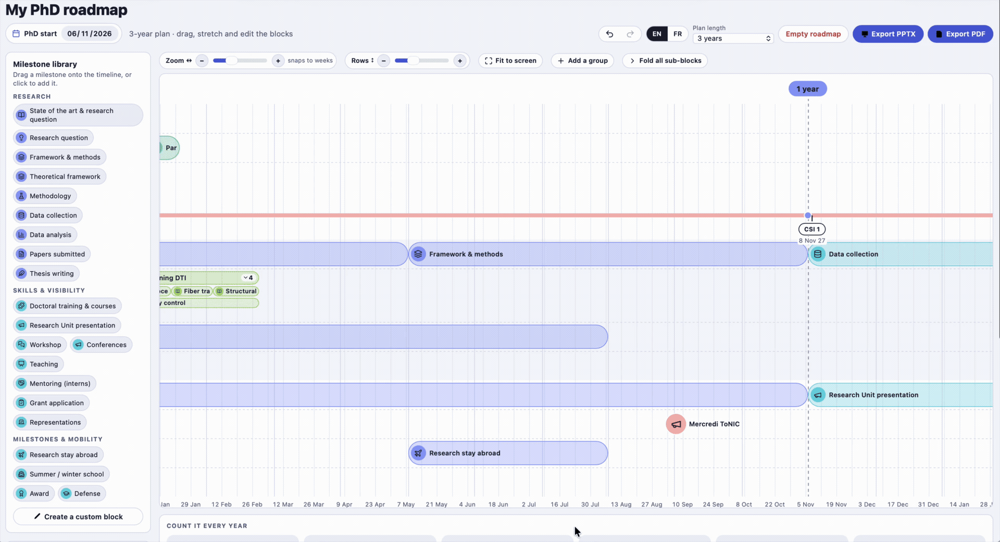

---

### 7. Zoom from years to days

| Control | Effect |
|---|---|
| **Zoom ↔** (− / slider / +) or <kbd>Ctrl</kbd> + scroll | Months → weeks → days |
| **Rows ↕** | Taller or shorter rows |
| **Fit to screen** | Back to the full plan |

Blocks snap to what you see: to months when zoomed out, to weeks, then to days. The label next to the zoom tells you which (*snaps to weeks*…).

<!-- 🎞️ GIF: zoom from the 3-year view down to days with Ctrl + scroll -->
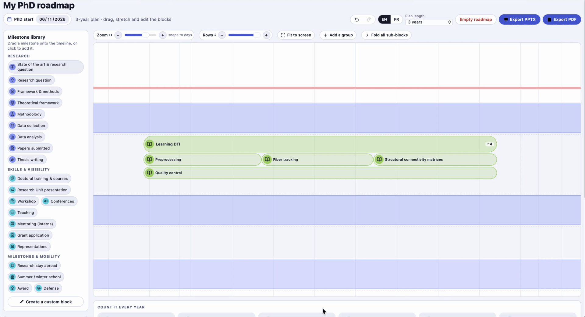

---

### 8. Yearly counters and personal goals

Under the timeline, **Count it every year** keeps track of what the CSI asks about: training hours, talks, conferences, publications, teaching, mentoring, representation…

| Action | How |
|---|---|
| ➕ Add a counter | *Yearly counters* panel (left), or **Create a custom counter** |
| 🔢 Count | Type a number, or use the **▲ ▼** arrows (or <kbd>↑</kbd> <kbd>↓</kbd> in the box) |
| 🎯 Set goals | Click the counter's title, then fill **Personal goals per year** |
| 📈 Follow progress | Each box shows `2 / 10`, a progress bar, and ✓ once the goal is reached |

> [!TIP]
> Set your goals **at the beginning of each year**, then update the counters before each CSI.

<!-- 📸 Counter tile with a goal: "6 / 10" + progress bar, and one box with ✓ -->
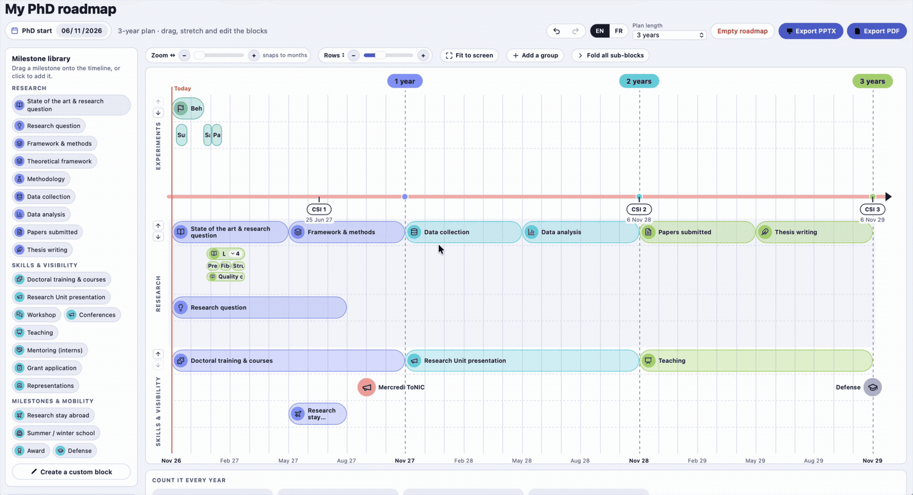

---

### 9. Save and reopen your work

Your roadmap is **saved automatically in your browser**. Close the page and it will be there next time, on the same computer and the same browser.

| To… | Do |
|---|---|
| Keep a backup, or move to another computer | **Save file** → a `.json` file |
| Continue from a backup | **Open file** → choose your `.json` |
| Undo / redo | ↶ ↷ buttons, or <kbd>Ctrl</kbd>+<kbd>Z</kbd> / <kbd>Ctrl</kbd>+<kbd>Y</kbd> |
| Start again from the template | **Default roadmap** |
| Start from scratch | **Empty roadmap** (can be undone) |

> [!WARNING]
> Clearing your browser data (cookies, site data) also erases your roadmap. **Save a file before each CSI.**
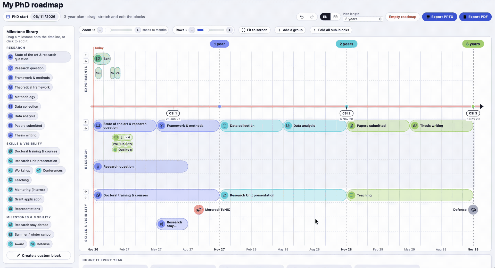
---

### 10. Export a poster (PPTX / PDF)

Click **Export PPTX** or **Export PDF**. The export window asks:

| Option | Choices |
|---|---|
| **Format** | PowerPoint (`.pptx`, fully editable) or PDF |
| **Period** | Whole plan · What is visible on screen · Custom period (e.g. *next 3 months*) |
| **Content** | Include sub-blocks? Include yearly counters? |

The result is an **A3 landscape** page, ready to print or to project. A short period fills the whole page, with a ruler in days or weeks.

<!-- 📸 Side by side: export window | resulting PDF (whole plan) | resulting PDF (3-month window) -->
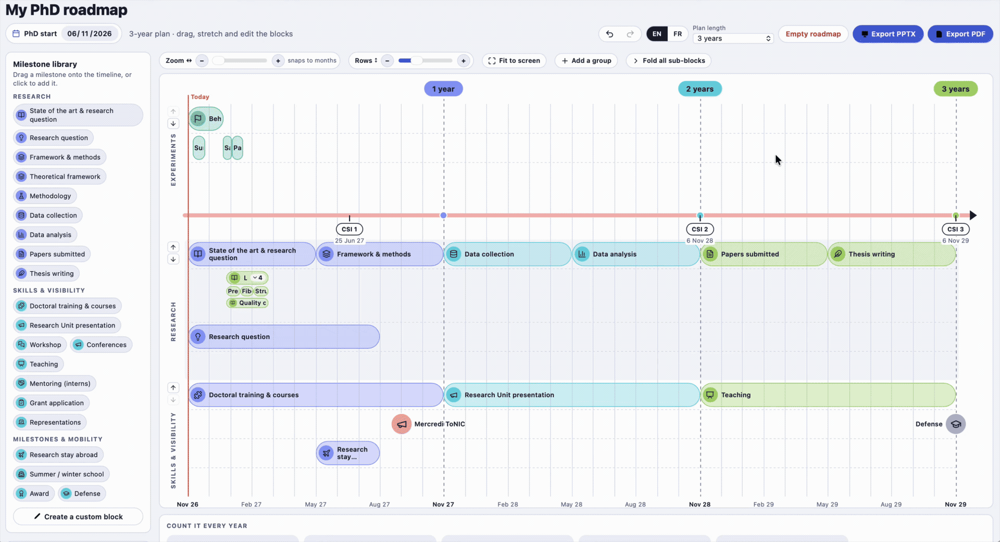

---

## ⌨️ Keyboard shortcuts

| Keys | Action |
|---|---|
| <kbd>←</kbd> <kbd>→</kbd> | Move the selected block |
| <kbd>Shift</kbd> + <kbd>←</kbd> <kbd>→</kbd> | Shorten / lengthen the selected block |
| <kbd>↑</kbd> <kbd>↓</kbd> | Move the selected block to the row above / below |
| <kbd>Enter</kbd> | Open the editor of the selected block |
| <kbd>Delete</kbd> | Delete the selected block |
| <kbd>Esc</kbd> | Close the editor or the export window |
| <kbd>Ctrl</kbd> + <kbd>Z</kbd> / <kbd>Ctrl</kbd> + <kbd>Y</kbd> | Undo / redo |
| <kbd>Ctrl</kbd> + scroll | Zoom in / out on the timeline |

*On a Mac, use <kbd>⌘</kbd> instead of <kbd>Ctrl</kbd>.*

---

## 📝 The fillable CSI tracker (PDF)

`My_PhD_Tracker.pdf` and `Mon_suivi_de_thèse.pdf` follow the criteria of the graduate school's **Document A2**.

1. Open the PDF in **Adobe Acrobat Reader**, **Preview** (Mac) or your browser.
2. **Click a dot** to fill it in black: *Planned* · *In progress* · *Done*.
3. **Type numbers** in the boxes (hours, number of talks, publications…).
4. **Save**, and bring it to your CSI.

Greyed cells don't apply to that criterion and cannot be filled in.

<!-- 📸 Tracker page with a few dots filled and numbers typed -->
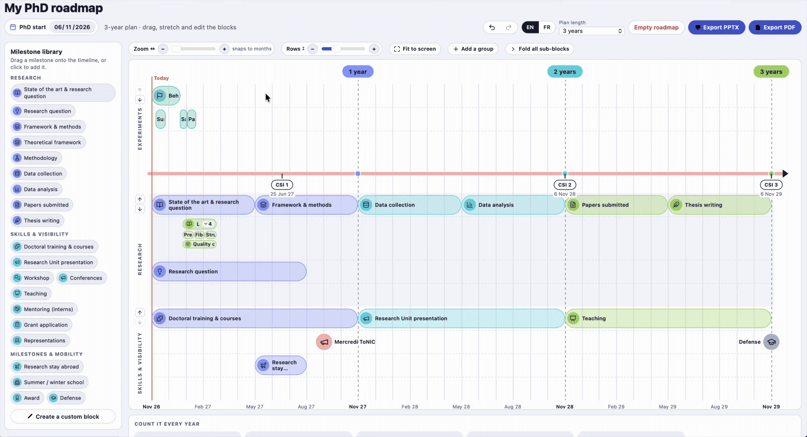

---

## 🔒 Privacy: where is my data?

- Everything stays **on your computer**. The builder never sends anything over the internet.
- Your roadmap is stored in your **browser's local storage**, and in the `.json` files you choose to save.
- Exports are generated **locally**, inside your browser.

---

## ❓ FAQ & troubleshooting

<b>The page opens but the timeline is empty or broken</b>

Click **Default roadmap** (bottom of the left panel). If that doesn't help, open the file in another browser, or clear this page's site data and reload.

<b>My roadmap isn't there on my other computer / browser</b>

The automatic save belongs to one browser on one computer. Use **Save file** on the first computer and **Open file** on the second.

<b>Nothing happens when I click Export</b>

Your browser may be blocking downloads from local files. Allow downloads for this page, or check your Downloads folder: the file may already be there.

<b>A title is cut in the PowerPoint export</b>

Long titles are cut to fit their block. Open the `.pptx` and widen the text box, or shorten the title in the builder.

<b>Can I use it on a tablet or a phone?</b>

You can view and lightly edit it, but dragging and resizing blocks is much more comfortable with a mouse or a trackpad.

<b>I found a bug / I have an idea</b>

Open an [issue](../../issues) with a screenshot, and attach your `.json` file if you can.

---

## 🛠️ For maintainers

<b>How the builder is made</b>

- A **single self-contained HTML file**: interface, logic and libraries are all inside.
- Embedded libraries:
  - [PptxGenJS](https://github.com/gitbrent/PptxGenJS) 3.12.0 (MIT) for PowerPoint export
  - [jsPDF](https://github.com/parallax/jsPDF) 2.5.1 (MIT) for PDF export
  - [Lucide](https://lucide.dev) icons (ISC)
- No build step and no server. Edit the file and reload the page.

<b>Changing the milestone and counter libraries</b>

Search the HTML file for:

- `const P = [`: the **milestone library**. One line per milestone: `key, icon, group (R/S/O), side, start month, length in months (0 = milestone), English label, French label`.
- `const CP = [`: the **counter library**. One line per counter: `key, icon, English title, English unit, French title, French unit`.
- `function defaults()`: the **default roadmap** shown to new users.

Keep the `key` values unique. Icon names come from the `ICONS` list in the same file.

<b>Releasing a new version</b>

1. Test the file in Chrome, Firefox and Safari.
2. Update the changelog below.
3. Create a GitHub **Release** and attach `PhD_Roadmap_Builder.html`, so people can download it in one click.

### Changelog

| Version | Date | Changes |
|---|---|---|
| 1.0 | 2026-11 | First public version: groups, sub-blocks, CSI dates, zoom, counters with goals, PPTX/PDF export with period selection |

---

Made for the **PhD follow-up committee**, ToNIC (Toulouse NeuroImaging Centre, UMR 1214 Inserm/UPS)
Contact: Paul Jacquart (paul.jacquart@inserm.fr)

*Questions? Ideas? Open an [issue](../../issues) or contact the committee.*

